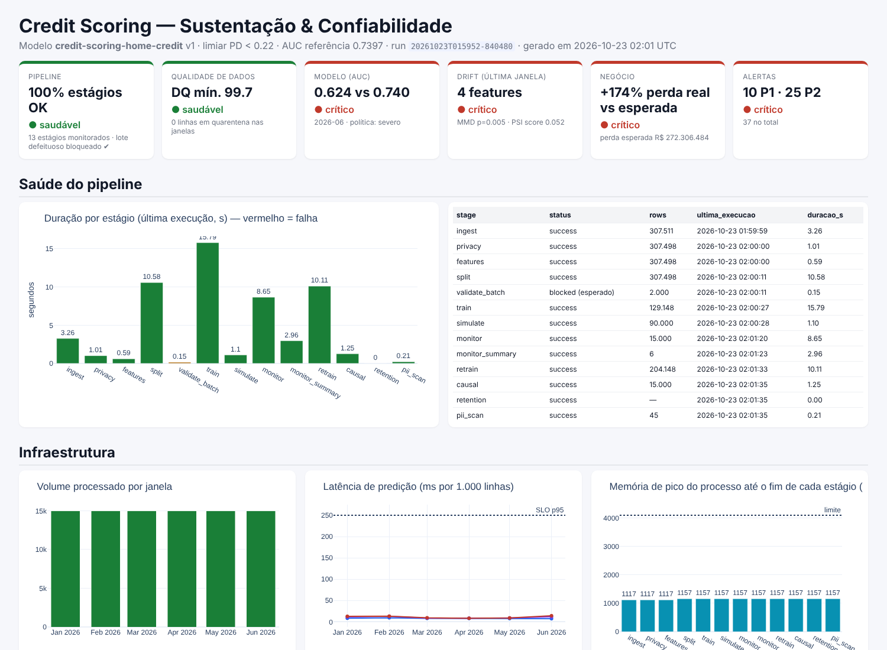
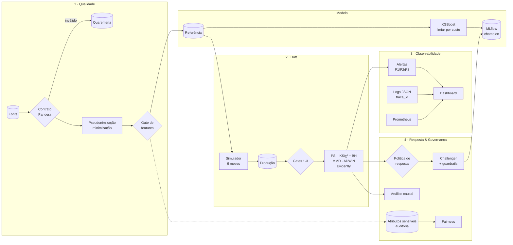
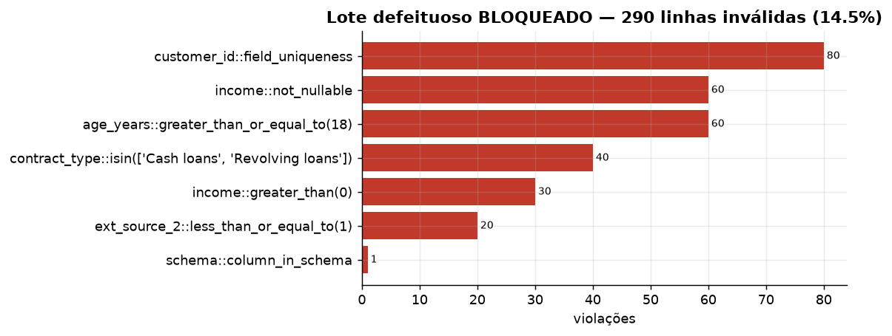
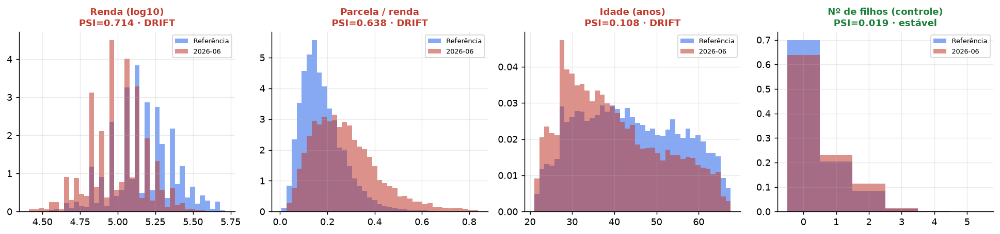
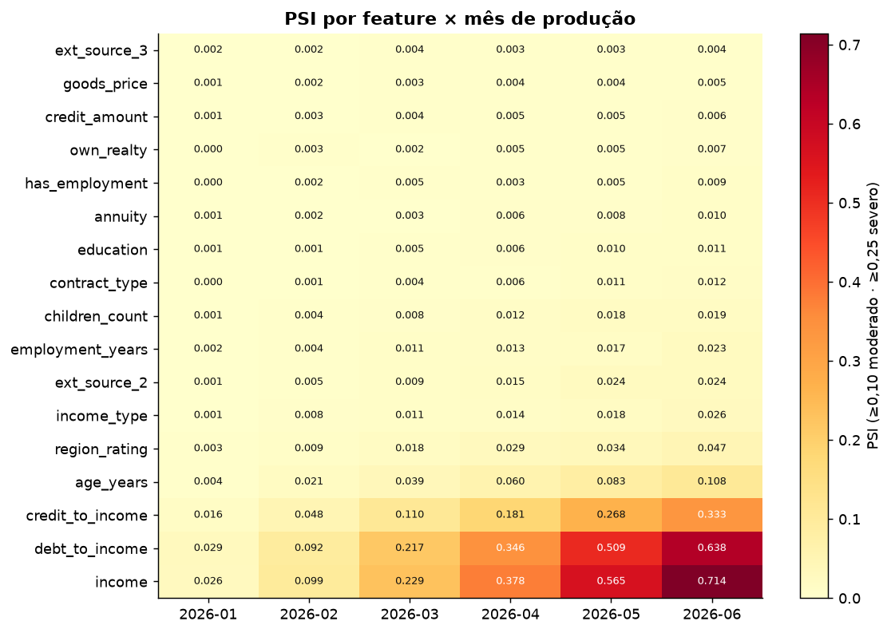
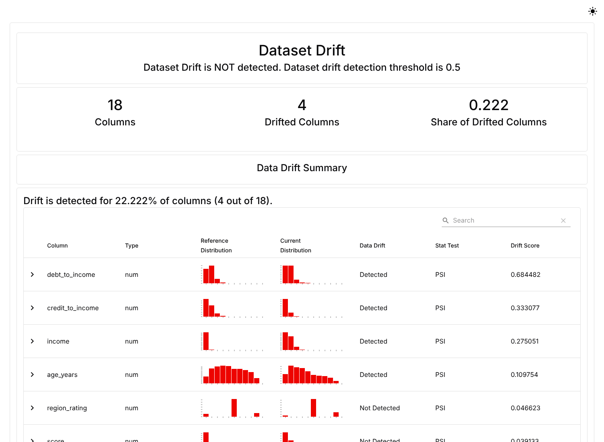
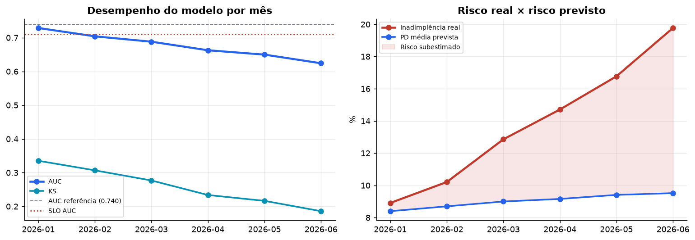
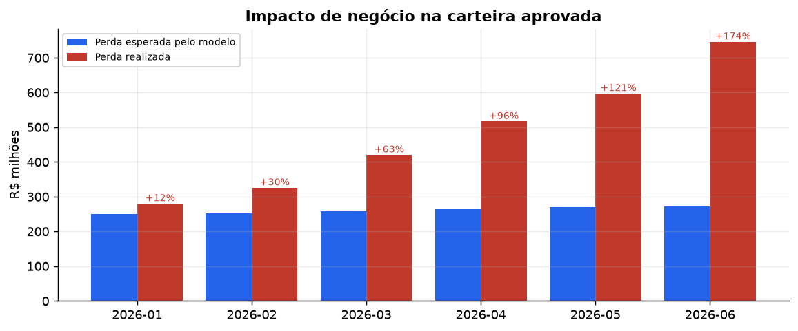
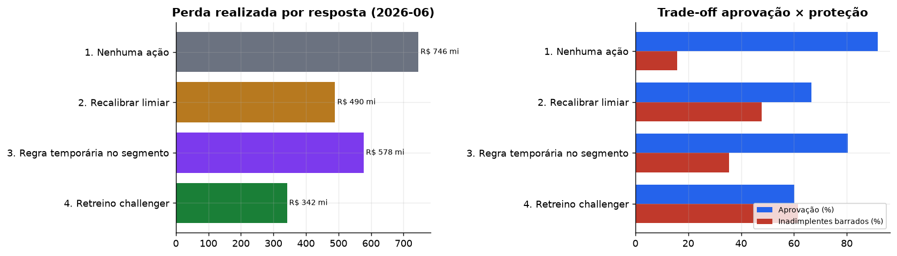
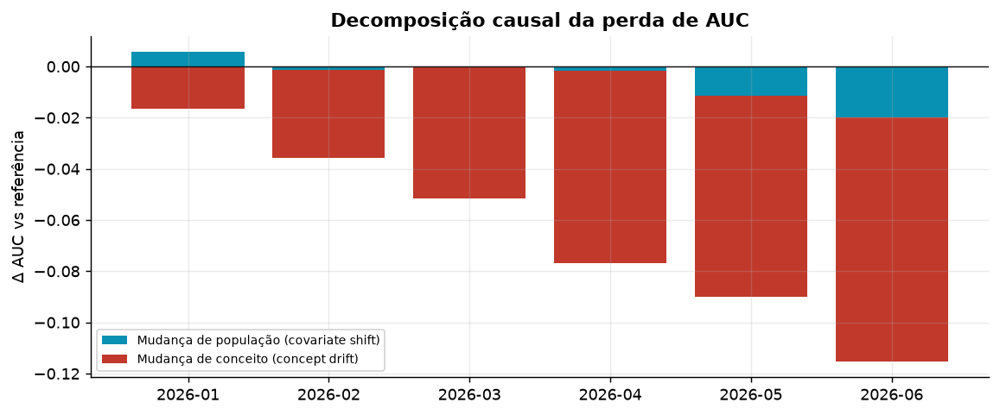

<div align="center">

# DriftGuard — Credit MLOps Monitoring

**Contratos de dados · Detecção de Data & Concept Drift · Observabilidade · Governança LGPD**

*Camada de sustentação que impede um modelo de crédito em produção de degradar em silêncio.*




</div>

---

## Sumário

- [O problema](#o-problema)
- [Resultados em 30 segundos](#resultados-em-30-segundos)
- [Arquitetura](#arquitetura)
- [1. Contratos de dados: lixo não entra no modelo](#1-contratos-de-dados-lixo-não-entra-no-modelo)
- [2. Simulação e detecção de drift](#2-simulação-e-detecção-de-drift)
- [3. Observabilidade: logs, métricas, rastreamento e alertas](#3-observabilidade-logs-métricas-rastreamento-e-alertas)
- [4. Correções: política de resposta com guardrails](#4-correções-política-de-resposta-com-guardrails)
- [5. Análise causal](#5-análise-causal)
- [6. Governança e LGPD](#6-governança-e-lgpd)
- [Como executar](#como-executar)
- [Testes e qualidade](#testes-e-qualidade)
- [Estrutura do projeto](#estrutura-do-projeto)
- [Decisões de arquitetura (ADRs)](#decisões-de-arquitetura-adrs)

---

## O problema

Uma fintech de crédito tem um modelo de *Credit Scoring* em produção. Com inflação, juros altos e a
chegada de um público novo pelo canal digital, o mundo mudou, mas o modelo continua decidindo como se
nada tivesse acontecido. O endpoint responde `HTTP 200`, a latência está ótima, e mesmo assim a
carteira aprovada passa a perder muito mais dinheiro do que o previsto.

O **DriftGuard** envolve o modelo com uma camada de confiabilidade que:

1. **Intercepta dados ruins** antes que cheguem ao modelo (contratos de dados com circuit breaker).
2. **Detecta drift** nos dados (univariado e multivariado) e no conceito (queda de desempenho com rótulo atrasado).
3. **Torna tudo observável:** logs estruturados correlacionados, métricas Prometheus, MLflow, alertas com runbook e dashboard.
4. **Recomenda a correção:** compara 4 respostas possíveis em custo, perda e fairness, e só promove um novo modelo que passe nos guardrails.
5. **Explica a causa:** decompõe a degradação entre mudança de população e mudança de conceito.
6. **Respeita a LGPD por design:** pseudonimização, minimização, segregação de atributos sensíveis, motivos da decisão e retenção.

Dataset: [Home Credit Default Risk](https://www.kaggle.com/competitions/home-credit-default-risk/data) (`application_train.csv`, **307.511 clientes**, 8,1% de inadimplência).

---

## Resultados em 30 segundos

| Pergunta | Resposta do DriftGuard |
|---|---|
| O contrato barra dados ruins? | **Sim.** O lote defeituoso (14,5% de linhas inválidas + coluna não contratada) foi **bloqueado com exit code 2** e enviado à quarentena. Na fonte real, 13 linhas inválidas foram para a quarentena sem bloquear o fluxo. |
| O drift foi detectado? | **Sim, nas 4 variáveis alteradas e em nenhuma de controle.** Renda PSI **0,714**, parcela/renda **0,638**, crédito/renda **0,333**, idade **0,108**. Controles abaixo de 0,05. O ADWIN marcou o início da mudança em **fev/2026**. |
| Quanto o modelo degradou? | AUC **0,740 → 0,624**. A inadimplência real foi a **19,8%** enquanto o modelo previa **9,5%**, e a perda realizada ficou **+174%** acima da esperada. |
| Qual a causa? | **Concept drift** no segmento de alto comprometimento de renda: −0,095 de AUC, contra −0,020 da mudança de população. |
| Qual correção? | **Retreino challenger** aprovado em todos os guardrails: AUC **0,701**, perda realizada **−54%** (R$ 746 mi → R$ 342 mi), inadimplentes barrados **16% → 62%**. |
| E a LGPD? | PII pseudonimizada, gênero fora do modelo e auditado (regra 4/5 ✔), motivos da decisão por proposta, varredura de PII **sem achados**. |

---

## Arquitetura



**Duas camadas** ([ADR-0001](docs/adr/0001-caminho-principal-e-opcionais.md)):

- **caminho principal:** roda com um comando, sem Docker nem servidor;
- **componentes opcionais:** Airflow, OpenTelemetry, Prometheus + Grafana e NannyML, desacoplados por adaptadores.

Arquitetura completa em [`docs/ARCHITECTURE.md`](docs/ARCHITECTURE.md).

---

## 1. Contratos de dados: lixo não entra no modelo

O contrato [`contracts/credit_application.v1.yaml`](contracts/credit_application.v1.yaml) segue a
*Data Contract Specification* e é a **fonte única da verdade**: o schema Pandera é **gerado** a partir
dele ([ADR-0003](docs/adr/0003-contrato-yaml-como-fonte-da-verdade.md)). Ele tem dono, versão,
finalidade de uso, SLAs e **41 checagens bloqueantes**, entre elas:

| Regra rígida | Exemplo de violação |
|---|---|
| Sem duplicatas de `customer_id` | mesmo cliente enviado duas vezes |
| Idade ≥ 18 e ≤ 100 | proponente de 16 anos |
| Renda **não nula** e > 0 | renda ausente ou negativa |
| Categorias dentro do domínio | `contract_type = "Crypto loans"` |
| Scores de bureau ∈ [0, 1] | `ext_source_2 = 1,7` |
| Schema estrito | coluna `CPF_CLIENTE` não prevista (vazamento de PII) |
| Volume mínimo | lote com menos de 1.000 propostas |

**Circuit breaker** ([ADR-0004](docs/adr/0004-circuit-breaker-e-quarentena.md)):

- violação estrutural **ou** mais de 5% de linhas inválidas → **lote inteiro bloqueado**;
- abaixo disso → só as linhas ruins vão para a quarentena, com o motivo de cada uma.

```console
$ python -m driftguard bad-batch
[CRITICAL] validate_batch INGESTION_BLOCKED   {"rows": 2000, "invalid_rows": 290, "reason": "violação estrutural:
           credit_application@1.0.0::column_in_schema | circuit breaker: 14.5% de linhas inválidas > 5%"}
✘ LOTE BLOQUEADO pelo contrato de dados (gate1_contract)
$ echo $?
2
```



**Além das regras:**

- **Três quality gates:** registro bruto → features derivadas → entrada do modelo (*training-serving skew*).
- **Data Quality Score** nas 6 dimensões de qualidade. Fonte real: **99,84**; janelas de produção: ≥ 99,66.
- **Diagnóstico de nulos:** a ausência de `ext_source_3` é **não-MCAR** (inadimplência 9,3% quando nulo × 7,8% quando preenchido, p < 1e-35). Por isso o nulo é preservado e tratado nativamente pelo XGBoost, em vez de imputado.
- **Referência × Produção** com IDs disjuntos e **zero** duplicatas exatas ou aproximadas (hashing quantizado).

**Modelo base** (XGBoost, 184.498 clientes na referência):

| Conjunto | AUC | KS | Brier | Aprovação | Bad rate dos aprovados |
|---|---|---|---|---|---|
| Validação | 0,7525 | 0,378 | 0,0683 | 94,2% | 6,59% |
| Teste | **0,7397** | 0,359 | 0,0689 | 94,3% | 6,77% |

O limiar de decisão vem do **custo esperado** (LGD 45% × margem 10%): aprova se **PD < 0,22**.
Model card em [`reports/model/MODEL_CARD.md`](reports/model/MODEL_CARD.md).

---

## 2. Simulação e detecção de drift

### Cenário: 6 meses de deterioração econômica

| Mecanismo | Como foi simulado | Variáveis |
|---|---|---|
| **Data drift** (covariate shift) | Reamostragem ponderada da carteira. Muda P(X) e **preserva P(Y\|X)** | renda ↓ (inflação), parcela/renda ↑, público mais jovem |
| **Drift multivariado** | Condições do empréstimo desacopladas da renda em até 35% da carteira | crédito/renda |
| **Concept drift** | No segmento vulnerável, até 20% dos bons pagadores passam a inadimplir. **P(Y\|X) muda com X igual** | rótulo |
| **Controles** | Não alterados: provam que o detector não dispara à toa | nº de filhos, rating da região |

O gabarito da simulação fica separado e é usado **somente** para validar a análise causal.

### Distribuições: referência × jun/2026



### Bateria estatística ([ADR-0005](docs/adr/0005-bateria-estatistica-de-drift.md))

| Pergunta | Técnica |
|---|---|
| Quanto mudou? | **PSI** com bins pelos quantis da referência |
| É real ou ruído? | **KS** (numéricas) e **χ²** (categóricas) com correção **Benjamini-Hochberg** e efeito mínimo D ≥ 0,10 |
| A relação entre variáveis mudou? | **MMD²** (kernel RBF, p-valor por permutação) |
| Quando começou? | **ADWIN** sobre o fluxo de scores |
| É relevante para o modelo? | PSI × importância da feature |
| Relatório auditável | **Evidently AI**: um HTML por mês + consolidado com KS/χ²/Wasserstein |



### Detectado × injetado (validação contra o gabarito)

| Feature | Mecanismo injetado | PSI jun/26 | Drift detectado |
|---|---|---|---|
| `income` | covariate | **0,714** | ✅ |
| `debt_to_income` | covariate | **0,638** | ✅ |
| `credit_to_income` | multivariado | **0,333** | ✅ |
| `age_years` | covariate | **0,108** | ✅ |
| `children_count` | controle | 0,019 | ⬜ estável |
| `region_rating` | controle | 0,047 | ⬜ estável |

O Evidently confirma o mesmo resultado: **4 de 18 colunas** com drift em jun/2026 (relatórios em
[`reports/drift/`](reports/drift)).



### Degradação do modelo

| Mês | Features com drift | MMD² | AUC | KS | Brier | Inadimplência real | PD prevista | Perda real vs esperada | Política |
|---|---|---|---|---|---|---|---|---|---|
| 2026-01 | 0 | 0,003 | 0,729 | 0,335 | 0,075 | 8,9% | 8,4% | +12% | leve |
| 2026-02 | 2 | 0,005 | 0,704 | 0,307 | 0,086 | 10,2% | 8,7% | +30% | **severa** |
| 2026-03 | 3 | 0,029 | 0,688 | 0,277 | 0,107 | 12,9% | 9,0% | +63% | **severa** |
| 2026-04 | 4 | 0,045 | 0,663 | 0,234 | 0,123 | 14,7% | 9,2% | +96% | **severa** |
| 2026-05 | 4 | 0,058 | 0,650 | 0,217 | 0,138 | 16,8% | 9,4% | +121% | **severa** |
| 2026-06 | 4 | 0,084 | **0,624** | 0,186 | 0,164 | **19,8%** | **9,5%** | **+174%** | **severa** |




---

## 3. Observabilidade: logs, métricas, rastreamento e alertas

| Pilar | Implementação |
|---|---|
| **Logs** | JSON estruturado, um evento por linha (`logs/pipeline.jsonl`), correlacionado por `run_id`, `trace_id` e `span_id`. Registra sucesso e falha de ingestão, transformação, treino e resultados de drift |
| **Métricas** | `prometheus-client`: duração e status de cada estágio, linhas processadas e rejeitadas, DQ Score, PSI por feature, MMD, AUC, Brier, perda esperada, disparate impact, latência p50/p95/p99, memória e CPU ([catálogo](docs/METRICS.md)) |
| **Rastreamento** | **MLflow**: experimento de treino (parâmetros, métricas, hash dos datasets, modelo registrado com aliases `champion`/`challenger`) e experimento de monitoramento com **um run por mês** |
| **Alertas** | Severidade → P1/P2/P3, roteamento por time, **alertas compostos** (drift + queda de AUC), deduplicação e [runbook](docs/RUNBOOK.md) |
| **Dashboard** | HTML autocontido em 3 níveis ([`reports/dashboard/index.html`](reports/dashboard/index.html)), além de um dashboard Grafana provisionado (opcional) |

Exemplo de alerta composto gerado em jun/2026:

```json
{
  "type": "CONCEPT_DRIFT", "severity": "critical", "priority": "P1",
  "title": "Queda de AUC além do SLO + drift nos dados (alerta composto)",
  "window": "window_06", "details": {"auc": 0.6243, "baseline": 0.7397, "drop": 0.1154},
  "action": "Aplicar regra de negócio temporária no segmento afetado e disparar retreino (challenger com guardrails).",
  "route": "ml-engineering + risco-de-credito", "runbook": "docs/RUNBOOK.md#concept-drift"
}
```

**Alertas na execução de referência:** 37 no total, sendo 10 P1, 25 P2 e 2 P3. Os tipos foram
`CONCEPT_DRIFT`, `BUSINESS_IMPACT`, `DATA_DRIFT`, `MULTIVARIATE_DRIFT`, `MODEL_CALIBRATION` e
`DATA_QUALITY`.

---

## 4. Correções: política de resposta com guardrails

Detectar não basta: é preciso responder na proporção certa ([ADR-0006](docs/adr/0006-politica-de-resposta-em-camadas.md)).
Quando a política chega a **severa**, o DriftGuard avalia quatro respostas no mês mais recente
(jun/2026). O challenger é treinado só com os meses **cujo rótulo já chegou**.

| Resposta | AUC | Aprovação | Inadimplentes barrados | Bad rate aprovados | Custo esperado | Perda realizada | DI gênero (≥ 0,80) |
|---|---|---|---|---|---|---|---|
| 1. Nenhuma ação | 0,624 | 91,8% | 15,8% | 18,1% | R$ 784,6 mi | R$ 745,9 mi | 0,963 ✔ |
| 2. Recalibrar limiar (0,22 → 0,10) | 0,624 | 66,7% | 47,8% | 15,5% | R$ 677,5 mi | R$ 489,6 mi | 0,867 ✔ |
| 3. Regra temporária no segmento | 0,624 | 80,3% | 35,4% | 15,9% | R$ 686,9 mi | R$ 578,0 mi | 0,976 ✔ |
| **4. Retreino challenger** | **0,701** | 60,2% | **61,5%** | **12,7%** | **R$ 592,0 mi** | **R$ 341,7 mi** | 0,976 ✔ |



**Guardrails de promoção do challenger:**

| Guardrail | Resultado |
|---|---|
| AUC global melhor | ✅ 0,624 → 0,701 |
| Segmento crítico não pior | ✅ 0,579 → 0,596 |
| Regra dos 4/5 no atributo protegido (gênero) | ✅ 0,976 |
| Calibração (Brier) melhor | ✅ 0,164 → 0,151 |
| Custo esperado menor | ✅ −25% |

**Decisão:** challenger **promovido** a `champion` no MLflow Model Registry.

**Ponto de atenção registrado:** a aprovação de clientes de 18–25 anos cai bastante (*disparate impact*
da faixa etária de 0,48). Idade é fator de risco legítimo e monitorado, sem bloqueio
([ADR-0008](docs/adr/0008-atributos-sensiveis-fora-do-modelo.md)), mas a queda exige revisão de
política comercial com Risco e Compliance antes da ampliação.

---

## 5. Análise causal

Hipótese causal: inflação → renda real ↓ e parcelas ↑ → comprometimento de renda ↑ → inadimplência ↑.
O canal digital traz um público mais jovem e limites desacoplados da renda.

**Decomposição:** o mesmo mês é avaliado com o rótulo real e com o rótulo **contrafactual**
(comportamento que os mesmos clientes teriam sem a mudança de risco).



| Jun/2026 | Valor |
|---|---|
| AUC referência → real | 0,740 → 0,624 |
| Efeito da mudança de população (covariate shift) | −0,020 |
| Efeito da mudança de conceito (concept drift) | **−0,095** |
| Segmento vulnerável: inadimplência real × prevista | **28,6% × 9,9%** |
| Demais clientes: inadimplência real × prevista | 9,7% × 9,1% |

**Conclusão:** a perda de desempenho é dominada pelo **concept drift no segmento de alto
comprometimento de renda**. O modelo ainda ordena bem a nova população, mas **subestima o risco**
de quem já estava apertado. A **ablação contrafactual** (cada feature devolvida à distribuição de
referência) quantifica quanto cada mudança de população move a PD média e a aprovação. Relatório
completo em [`reports/causal/attribution.md`](reports/causal/attribution.md).

---

## 6. Governança e LGPD

### Dados pessoais e como foram tratados

| Dado | Classificação | Tratamento |
|---|---|---|
| `SK_ID_CURR` → `customer_id` | Identificador direto | **Pseudonimização HMAC-SHA256** com salt secreto (variável de ambiente, nunca no Git) |
| Gênero, estado civil | Risco de discriminação | **Segregados** numa tabela de auditoria e **nunca usados como feature** |
| Idade | Quase-identificador | Feature de risco; nos relatórios aparece **apenas em faixas** |
| Renda, crédito, parcela, scores de bureau | Pessoais financeiros | Nenhuma publicação individual; relatórios só agregados (grupos com n < 30 suprimidos) |
| ~104 colunas restantes da fonte | — | **Não são lidas** (minimização na fonte) |

Inventário completo em [`docs/governance/PII_INVENTORY.md`](docs/governance/PII_INVENTORY.md).

**Controles verificados por código, não só declarados:**

- `driftguard pii-scan` varre logs e relatórios: **0 achados**;
- o schema estrito barra campos pessoais não contratados, como o `CPF_CLIENTE` do lote de teste;
- os testes usam apenas **dados sintéticos**.

### Base legal da decisão de crédito

| Tratamento | Base legal (LGPD) |
|---|---|
| Análise de risco para concessão | **Art. 7º, X: proteção do crédito** |
| Coleta para avaliar a proposta | Art. 7º, V: procedimentos preliminares a contrato, a pedido do titular |
| Monitoramento de qualidade, drift e vieses | Art. 7º, IX: legítimo interesse (com teste de balanceamento no RIPD) |
| Decisão automatizada | **Art. 20:** motivos da decisão por proposta + revisão humana sob solicitação |

Exemplo de motivos gerados (contribuições do próprio XGBoost), em
[`reports/model/decision_reasons_sample.csv`](reports/model/decision_reasons_sample.csv):

| Cliente (pseudônimo) | PD | Motivo 1 | Motivo 2 | Motivo 3 |
|---|---|---|---|---|
| `c79bc70f…` | 23,7% | score de bureau externo (fonte 2) baixo | score de bureau externo (fonte 3) baixo ou ausente | valor do bem financiado |
| `c0c4b12b…` | 30,5% | score de bureau externo (fonte 2) baixo | comprometimento de renda com a parcela elevado | faixa etária |

### Plano de retenção

| Artefato | Prazo |
|---|---|
| Quarentena (dados inválidos) | 30 dias |
| Logs operacionais | 90 dias |
| Janelas de monitoramento | 365 dias |
| Referência de treino + modelo | vida útil do modelo + 5 anos |
| Relatórios agregados (sem dado individual) | indeterminado |

A política é executável: `python -m driftguard retention` (dry-run) ou `--apply`. Detalhes em
[`RETENTION.md`](docs/governance/RETENTION.md).

### Mitigação de vieses

- **Gênero** é atributo **protegido**: fica fora do modelo, a regra dos 4/5 é medida **todo mês** (≥ 0,96 em todos os meses) e é **guardrail** que veta a promoção de modelos.
- **Faixa etária** é **monitorada** por *equal opportunity* e *disparate impact*, com alerta informativo.
- O drift pode criar vieses que não existiam no treino. Por isso a fairness é medida **por janela**, não só no treino.

Documentos completos:

- [Registro das operações de tratamento (ROPA)](docs/governance/ROPA.md)
- [Relatório de impacto à proteção de dados (RIPD)](docs/governance/RIPD.md)
- [Model card](reports/model/MODEL_CARD.md)

---

## Como executar

### Pré-requisitos

- Python 3.10–3.12 (validado em 3.11)
- `application_train.csv` do [Home Credit Default Risk](https://www.kaggle.com/competitions/home-credit-default-risk/data) em `data/raw/`. Sem ele, use o modo demo.

### Instalação

```bash
git clone https://github.com/Henry3151/driftguard-credit-mlops.git
cd driftguard-credit-mlops
python -m venv .venv && source .venv/bin/activate    # Windows: .venv\Scripts\activate
pip install -r requirements-dev.txt && pip install -e .
cp .env.example .env                                  # defina DRIFTGUARD_PSEUDONYM_SALT
```

### Execução

```bash
python -m driftguard all        # pipeline completo com o dataset real (~2 min)
python -m driftguard demo       # pipeline completo com dados sintéticos (sem baixar nada)
```

Para ver os resultados:

- **Dashboard:** abra `reports/dashboard/index.html` no navegador.
- **Rastreamento:** `make mlflow` (ou `mlflow ui --backend-store-uri sqlite:///mlflow.db`) e acesse http://localhost:5000.

### Comandos

| Comando | O que faz |
|---|---|
| `ingest` | Lê a fonte, aplica o contrato (gates 1 e 2), pseudonimiza e separa Referência × Produção |
| `bad-batch` | Gera um lote defeituoso e prova que o contrato **bloqueia** a ingestão (exit 2) |
| `validate --batch arquivo.csv` | Valida qualquer lote (exit 0 = aceito, 2 = bloqueado) |
| `train` | Treina o XGBoost, define o limiar por custo e registra no MLflow (`champion`) |
| `simulate` | Gera 6 meses de produção com data drift, concept drift e controles |
| `monitor` | Gates, predição, PSI/KS/MMD, Evidently, desempenho, fairness, alertas e MLflow |
| `retrain` | Avalia as 4 respostas e promove o challenger se passar nos guardrails |
| `causal` | Decomposição covariate × concept e ablação contrafactual |
| `pii-scan` / `retention` | Controles de privacidade e retenção |
| `dashboard` / `figures` | Dashboard HTML e gráficos da documentação |

### Stack opcional de observabilidade

```bash
make observability                                   # Prometheus + Pushgateway + Grafana (Docker)
DRIFTGUARD_PUSHGATEWAY_URL=http://localhost:9091 python -m driftguard monitor
# Grafana: http://localhost:3000 → pasta "Credit Scoring"
```

Para orquestrar com Airflow, use o DAG [`orchestration/airflow/dags/credit_risk_monitoring.py`](orchestration/airflow/dags/credit_risk_monitoring.py).
Ele tem retries com backoff exponencial, SLA por tarefa e callback de falha.

---

## Testes e qualidade

```console
$ pytest
tests/test_alerts_policy.py ....         # deduplicação, roteamento e política em camadas
tests/test_contract.py ......            # cada regra do lote defeituoso é capturada; quarentena × bloqueio
tests/test_e2e.py .                      # pipeline completo com dados sintéticos
tests/test_privacy.py ....               # pseudonimização, segregação, varredura de PII
tests/test_split_and_simulation.py ...   # disjunção ref × prod, vazamento, drift só onde foi injetado
tests/test_stats.py ..........           # PSI (valor conhecido + propriedade PSI ≥ 0), BH, KS, MMD, ADWIN
============================== 28 passed ==============================
```

- **CI (GitHub Actions):**
  - `lint` (ruff);
  - `tests`;
  - `core-clean-env`: e2e + prova de bloqueio, **sem nenhum componente opcional**;
  - `optional-smoke`: OpenTelemetry ligado + sintaxe do DAG;
  - `commitlint`.
- **Commits** no padrão [Conventional Commits](https://www.conventionalcommits.org/pt-br/), validado por *pre-commit* e *commitlint*.
- **Reprodutibilidade:** seeds fixas, dependências fixadas em `requirements.txt` e hashes dos datasets registrados no MLflow.

---

## Estrutura do projeto

```
driftguard-credit-mlops/
├── configs/                 # dataset.yaml · drift_scenario.yaml · slo.yaml · costs.yaml
├── contracts/               # credit_application.v1.yaml (Data Contract Specification)
├── src/driftguard/
│   ├── cli.py · pipeline.py · settings.py
│   ├── core/
│   │   ├── data/            # leitura canônica, split, vazamento, dados sintéticos
│   │   ├── privacy/         # pseudonimização, segregação, varredura de PII
│   │   ├── contracts/       # YAML → Pandera, gates, circuit breaker, DQ score
│   │   ├── model/           # XGBoost, limiar por custo, motivos da decisão
│   │   ├── drift/           # simulador, PSI/KS/χ²/BH/MMD/ADWIN, Evidently, política
│   │   ├── observability/   # logs, métricas, MLflow, alertas, dashboard, figuras
│   │   ├── governance/      # fairness, retenção
│   │   └── causal/          # decomposição e ablação contrafactual
│   └── adapters/            # opcionais: OpenTelemetry, Pushgateway, NannyML
├── tests/                   # 28 testes (unitários, contrato, propriedade, privacidade, e2e)
├── reports/                 # evidências versionadas da execução de referência
├── docs/                    # ARCHITECTURE · METRICS · RUNBOOK · adr/ · governance/ · images/
├── orchestration/airflow/   # DAG opcional
└── observability/           # Prometheus, regras de alerta e Grafana (opcional)
```

---

## Decisões de arquitetura (ADRs)

| ADR | Decisão |
|---|---|
| [0001](docs/adr/0001-caminho-principal-e-opcionais.md) | Caminho principal autossuficiente; componentes opcionais desacoplados |
| [0002](docs/adr/0002-pandera-como-framework-de-contratos.md) | Pandera como framework de contratos de dados |
| [0003](docs/adr/0003-contrato-yaml-como-fonte-da-verdade.md) | Contrato YAML como fonte da verdade; schema gerado |
| [0004](docs/adr/0004-circuit-breaker-e-quarentena.md) | Circuit breaker de 5% e quarentena por linha |
| [0005](docs/adr/0005-bateria-estatistica-de-drift.md) | Bateria estatística de drift + Evidently |
| [0006](docs/adr/0006-politica-de-resposta-em-camadas.md) | Política de resposta em camadas e guardrails |
| [0007](docs/adr/0007-mlflow-local-e-dashboard-html.md) | MLflow local + dashboard HTML (Grafana opcional) |
| [0008](docs/adr/0008-atributos-sensiveis-fora-do-modelo.md) | Atributos sensíveis fora do modelo; uso exclusivo em auditoria |

---

<div align="center">

Desenvolvido por **[Henry3151](https://github.com/Henry3151)** · Licença [MIT](LICENSE)

</div>
