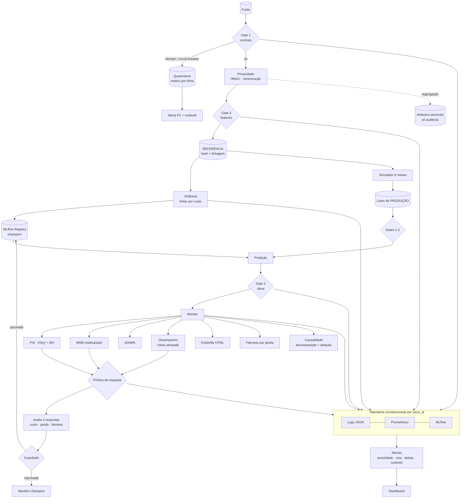

# Arquitetura

> **DriftGuard** é a camada de sustentação e confiabilidade de um modelo de *Credit Scoring* em produção.
> Ela intercepta dados ruins, detecta *data drift* e *concept drift*, mede o impacto no negócio,
> recomenda a resposta adequada e mantém o processo auditável sob a LGPD.

---

## 1. Princípios de desenho

| # | Princípio | Consequência prática |
|---|---|---|
| P1 | **Falhar alto, nunca em silêncio** | Contrato com severidades, circuit breaker, exit code 2, alerta P1 |
| P2 | **Shift left** | Validação em 3 pontos (bruto, features, entrada do modelo) antes de qualquer score |
| P3 | **Referência imutável e rastreável** | Referência pseudonimizada, com hash SHA-256 e linhagem no MLflow |
| P4 | **Detectar → diagnosticar → agir → revalidar** | Todo drift vira uma resposta proporcional, avaliada contra alternativas |
| P5 | **Privacy by Design & by Default** | PII tratada no primeiro estágio; atributos sensíveis nunca viram feature |
| P6 | **Reprodutibilidade** | `make all` (ou `make demo`) roda tudo sem Docker, servidor ou conta externa |
| P7 | **Decisões explícitas** | Cada escolha relevante tem um ADR em [`docs/adr`](adr/README.md) |

---

## 2. Duas camadas: caminho principal × opcionais

```
┌──────────────────────────── CAMINHO PRINCIPAL ───────────────────────────────────────────┐
│  python -m driftguard all  →  scikit-learn/XGBoost · Pandera · Evidently · MLflow (SQLite) │
│  prometheus-client (arquivo .prom) · dashboard HTML (Plotly) · relatórios versionados     │
│  Sem Docker · sem servidor · sem conta externa · executado no CI em ambiente limpo        │
└───────────────────────────────────────────────────────────────────────────────────────────┘
┌──────────────────────────── OPCIONAIS (desligados por padrão) ────────────────────────────┐
│  Airflow DAG · OpenTelemetry · Prometheus + Pushgateway + Grafana (docker) · NannyML CBPE │
│  Entram por adaptadores: sem a lib/flag → log OPTIONAL_COMPONENT_SKIPPED e o fluxo segue  │
└───────────────────────────────────────────────────────────────────────────────────────────┘
```

| Opcional | Ativação | Sem ele |
|---|---|---|
| Airflow | `orchestration/airflow/dags/credit_risk_monitoring.py` (chama a mesma CLI) | Orquestração pela CLI / `make` |
| OpenTelemetry | `DRIFTGUARD_OTEL_ENABLED=true` + `pip install .[extras]` | `trace_id`/`span_id` continuam nos logs JSON |
| Prometheus + Grafana | `make observability` + `DRIFTGUARD_PUSHGATEWAY_URL` | Métricas em `.prom` + dashboard HTML |
| NannyML (CBPE) | `pip install .[extras]` | Desempenho com rótulo atrasado continua disponível |

O núcleo (`src/driftguard/core`) nunca importa uma biblioteca opcional diretamente: tudo passa por
`src/driftguard/adapters/`. O job `core-clean-env` do CI prova essa independência.

---

## 3. Capacidades → componentes → evidências

| Capacidade | Componente | Evidência gerada |
|---|---|---|
| Contrato de dados | `contracts/credit_application.v1.yaml` → schema Pandera gerado | `reports/validation/*.json` |
| Bloqueio de lotes ruins | `core/contracts/gates.py` (circuit breaker + quarentena) | `data/quarantine/…`, log `INGESTION_BLOCKED`, exit 2 |
| Diagnóstico de nulos (MCAR/MNAR) | `pipeline._missingness_report` | `reports/validation/missingness_diagnostics.json` |
| Vazamento Referência × Produção | `core/data/leakage.py` | `reports/validation/leakage_reference_vs_production.json` |
| Modelo base | `core/model/train.py` (XGBoost + limiar por custo) | MLflow (alias `champion`), `reports/model/MODEL_CARD.md` |
| Simulação temporal | `core/drift/simulate.py` | `data/production/window_*.parquet`, `scenario.json` |
| Detecção estatística | `core/drift/stats.py` (PSI, KS, χ², BH, MMD, ADWIN) | `reports/drift/drift_summary.csv`, `adwin_score_stream.json` |
| Relatórios de drift | `core/drift/evidently_reports.py` | `reports/drift/evidently_*.html` |
| Política de resposta | `core/drift/policy.py` + `pipeline.retrain_challenger` | `reports/model/response_options.csv`, `challenger_evaluation.json` |
| Logs centralizados | `core/observability/logging.py` | `logs/pipeline.jsonl` |
| Métricas | `core/observability/metrics.py` | `reports/metrics/*.prom` |
| Rastreamento | `core/observability/tracking.py` | `mlflow.db` (`make mlflow`) |
| Alertas | `core/observability/alerts.py` | `reports/alerts.jsonl` |
| Dashboard | `core/observability/dashboard.py` | `reports/dashboard/index.html` |
| Fairness | `core/governance/fairness.py` | `reports/model/fairness_baseline.json`, `reports/monitoring/fairness_by_window.csv` |
| Motivos da decisão (LGPD art. 20) | `core/model/explain.py` | `reports/model/decision_reasons_sample.csv` |
| Causalidade | `core/causal/attribution.py` | `reports/causal/attribution.md` |
| Privacidade testada | `core/privacy/pii_scan.py` | `reports/governance/pii_scan.json` |
| Retenção | `core/governance/retention.py` | `reports/governance/retention_plan.json` |

---

## 4. Fluxo de ponta a ponta



---

## 5. Qualidade de dados e contratos

### 5.1 Contrato como produto

`contracts/credit_application.v1.yaml` segue a *Data Contract Specification* e é a fonte da verdade
(ADR-0003). Ele traz dono, versão, termos de uso (finalidade — LGPD art. 6º, I), compatibilidade
`backward`, prazo de aviso para mudanças que quebram e SLAs (freshness, completude, volume).

### 5.2 Regras e severidades

| Família de regra | Exemplos | Severidade |
|---|---|---|
| Schema | colunas obrigatórias, tipos, **nenhuma coluna desconhecida** (`strict`) | blocker |
| Unicidade | `customer_id` único | blocker |
| Completude | `income`, `annuity`, `age_years`… não nulos | blocker |
| Validade | `age_years ∈ [18, 100]`, `income ∈ (0, 1e8]`, `ext_source_* ∈ [0, 1]` | blocker |
| Domínio | categorias dentro do contrato (`isin`) | blocker |
| Volume | lote ≥ 1.000 linhas | blocker |
| Consistência | parcela ≤ valor do crédito | warning |
| Completude opcional | nulos em campos opcionais acima de 25% | warning |
| Distribuição | média de renda fora de ±30% da referência | warning |

São 41 checagens *blocker* geradas a partir do YAML.

### 5.3 Circuit breaker (ADR-0004)

- **Violação estrutural ou linhas inválidas acima de 5%:** o lote inteiro é bloqueado (exit code 2).
- **Até 5% de linhas inválidas:** só as linhas inválidas vão para a quarentena, com `reason_code`.

### 5.4 Três quality gates

| Gate | Onde | Protege contra |
|---|---|---|
| 1 | Registro canônico | Lixo na entrada |
| 2 | Features derivadas | Bugs de transformação (divisão por zero, infinitos) |
| 3 | Entrada do modelo | *Training-serving skew*: schema diferente do treino, valores fora do domínio |

### 5.5 Data Quality Score

O score (0–100) pondera as 6 dimensões de qualidade: completude, unicidade, validade, consistência,
acurácia (outliers robustos) e atualidade. É calculado por lote e acompanhado no dashboard.

---

## 6. Simulação e detecção de drift

### 6.1 Cenário (`configs/drift_scenario.yaml`)

| Mecanismo | Implementação | Efeito |
|---|---|---|
| Covariate shift | Reamostragem ponderada da carteira (`w ∝ exp(t·Σβz)`) | P(X) muda; P(Y\|X) preservado |
| Multivariado | Condições do empréstimo desacopladas da renda em até 35% da carteira | Correlação muda com marginais quase iguais |
| Concept drift | Bons pagadores do segmento vulnerável viram inadimplentes (até 20%) | P(Y\|X) muda com X igual |
| Controles | `children_count`, `region_rating` intocados | Prova de especificidade |

O gabarito da simulação (rótulo original, segmento, linhas desacopladas) é salvo à parte e usado
**apenas** para validar a análise causal, nunca pelo monitoramento.

### 6.2 Bateria de detecção (ADR-0005)

| Pergunta | Técnica |
|---|---|
| Quanto mudou? | PSI (bins pelos quantis da referência) |
| É significativo? | KS / χ² + Benjamini-Hochberg + efeito mínimo (D ≥ 0,10) |
| A relação entre variáveis mudou? | MMD² com kernel RBF e p-valor por permutação |
| Quando começou? | ADWIN sobre o fluxo de scores |
| Importa para o modelo? | PSI × importância da feature |
| O modelo piorou? | AUC / KS / Brier com rótulo atrasado |
| Relatório auditável | Evidently AI (`DataDriftPreset` + `ClassificationPreset`) |

---

## 7. Política de resposta (ADR-0006)

| Severidade | Gatilho | Resposta |
|---|---|---|
| Estável | sem drift relevante e AUC dentro do SLO | Monitoramento normal |
| Leve | drift em feature de baixa importância | Aumentar frequência de monitoramento |
| Moderada | drift severo em feature importante **ou** AUC −3 p.p. | Recalibrar limiar e investigar |
| Severa | drift **e** queda de AUC (alerta composto) | Regra temporária + retreino challenger |

Quando a política chega a "severa", quatro respostas são comparadas na janela mais recente:

1. nenhuma ação;
2. recalibração do limiar;
3. regra temporária no segmento;
4. retreino challenger.

O challenger só é promovido se passar nos guardrails: melhor AUC, segmento crítico não pior,
regra dos 4/5 no atributo protegido, Brier melhor e custo esperado menor.

---

## 8. Observabilidade (padrão SRE)

- **Logs:** JSON, um evento por linha, com `run_id`, `trace_id`, `span_id`, `stage`, `event`, `status`, `duration_ms` e `rows`.
- **Métricas:** prefixo `driftguard_`; catálogo completo em [`METRICS.md`](METRICS.md).
- **Rastreamento:**
  - experimento `credit-scoring-training`: modelo, datasets e respostas;
  - experimento `credit-scoring-monitoring`: um run por janela.
- **Alertas:** severidade → prioridade (P1/P2/P3), roteamento por tipo, alertas compostos, deduplicação e runbook ([`RUNBOOK.md`](RUNBOOK.md)).
- **Dashboard:** HTML autocontido em 3 níveis. Uma versão Grafana fica provisionada como opcional.

---

## 9. Governança

O detalhamento está em [`docs/governance`](governance):

- **ROPA:** registro das operações de tratamento de dados;
- **RIPD:** relatório de impacto à proteção de dados;
- **inventário de PII;**
- **política de retenção.**

O resumo executivo fica no README.

---

## 10. Estrutura do repositório

```
├── configs/            dataset.yaml · drift_scenario.yaml · slo.yaml · costs.yaml
├── contracts/          credit_application.v1.yaml
├── src/driftguard/
│   ├── cli.py · pipeline.py · settings.py
│   ├── core/{data,privacy,contracts,model,drift,observability,governance,causal}
│   └── adapters/       otel · pushgateway · nannyml_cbpe (opcionais)
├── tests/              unitários, contrato, privacidade, simulação, políticas, e2e
├── reports/            evidências versionadas (validação, drift, monitoramento, causalidade, dashboard)
├── docs/               ARCHITECTURE · METRICS · RUNBOOK · adr/ · governance/ · images/
├── orchestration/      DAG Airflow (opcional)
└── observability/      Prometheus · Pushgateway · Grafana (opcional)
```
