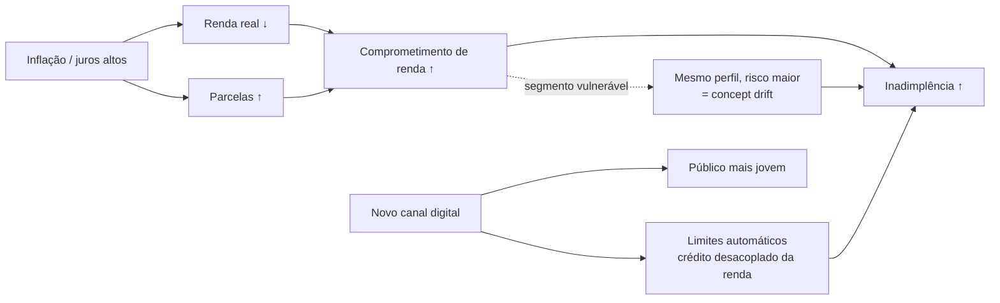

# Análise Causal da Degradação do Modelo

> Gerado pelo estágio `causal`. Dados: 6 janelas simuladas (ver `configs/drift_scenario.yaml`).

## 1. Hipótese causal (DAG)

## 2. Decomposição covariate shift × concept drift (por janela)

O modelo é avaliado em cada janela com o rótulo real e com o rótulo **contrafactual** (comportamento
que os mesmos clientes teriam sem a mudança de risco). A diferença isola o efeito do concept drift.

| month   |   auc_baseline |   auc_contrafactual_sem_concept |   auc_real |   efeito_covariate_shift_auc |   efeito_concept_drift_auc |   default_rate_real |   pd_media_prevista |   subestimacao_risco_pp |
|:--------|---------------:|--------------------------------:|-----------:|-----------------------------:|---------------------------:|--------------------:|--------------------:|------------------------:|
| 2026-01 |         0.7397 |                          0.7455 |     0.7288 |                       0.0058 |                    -0.0166 |              0.0891 |              0.084  |                    0.51 |
| 2026-02 |         0.7397 |                          0.7382 |     0.7041 |                      -0.0015 |                    -0.0341 |              0.1021 |              0.087  |                    1.51 |
| 2026-03 |         0.7397 |                          0.7395 |     0.6882 |                      -0.0002 |                    -0.0513 |              0.1286 |              0.09   |                    3.86 |
| 2026-04 |         0.7397 |                          0.738  |     0.6628 |                      -0.0017 |                    -0.0752 |              0.1471 |              0.0916 |                    5.55 |
| 2026-05 |         0.7397 |                          0.7282 |     0.6499 |                      -0.0115 |                    -0.0784 |              0.1677 |              0.0941 |                    7.35 |
| 2026-06 |         0.7397 |                          0.7197 |     0.6243 |                      -0.02   |                    -0.0954 |              0.1977 |              0.0952 |                   10.26 |

**Leitura (última janela, 2026-06):** a AUC foi de 0.7397 (referência) para 0.6243.
A mudança de população explica -0.0200 e o concept drift explica
-0.0954. O modelo prevê PD média de 9.52%, mas a
inadimplência real foi 19.77%: **risco subestimado em 10.26 p.p.**

## 3. Onde o conceito mudou (segmento vulnerável, última janela)

| Grupo | n | Default real | Default sem concept drift | PD prevista |
|---|---|---|---|---|
| Segmento vulnerável (DTI alto + renda baixa) | 7986 | 28.64% | 10.26% | 9.89% |
| Demais clientes | 7014 | 9.68% | 9.68% | 9.09% |

## 4. Ablação contrafactual por feature (última janela)

Cada feature é devolvida à distribuição da referência (*quantile mapping*); o quanto a PD média
prevista e a taxa de aprovação "voltam" mede a contribuição de cada mudança de distribuição.
Variação total vs. referência: PD média 1.384 p.p., aprovação -2.45 p.p.

| feature       |   delta_pd_media_pp |   share_mudanca_pd |   delta_aprovacao_pp |   share_mudanca_aprovacao |
|:--------------|--------------------:|-------------------:|---------------------:|--------------------------:|
| age_years     |               0.177 |              0.128 |               -0.26  |                     0.106 |
| annuity       |               0.162 |              0.117 |               -0.447 |                     0.182 |
| income        |               0.135 |              0.097 |               -0.42  |                     0.171 |
| credit_amount |               0.06  |              0.043 |               -0.187 |                     0.076 |

## 5. Validação: detectado × injetado

| feature          | mecanismo_injetado            |     psi | drift_detectado   |
|:-----------------|:------------------------------|--------:|:------------------|
| income           | covariate (reamostragem)      | 0.71421 | True              |
| debt_to_income   | covariate (reamostragem)      | 0.63832 | True              |
| age_years        | covariate (reamostragem)      | 0.10798 | True              |
| credit_to_income | multivariado (desacoplamento) | 0.3331  | True              |
| children_count   | controle (não alterada)       | 0.01918 | False             |
| region_rating    | controle (não alterada)       | 0.04662 | False             |

## 6. Conclusão e prescrição

1. **Causa raiz:** a degradação de desempenho é dominada pelo **concept drift** no segmento de alto
   comprometimento de renda e renda baixa. A mudança de população (renda menor, parcelas maiores,
   público jovem) desloca as features, mas o modelo ainda ordena bem esses clientes.
2. **Impacto de negócio:** o modelo **subestima o risco** (PD prevista < inadimplência real), o que
   aprova crédito demais no segmento vulnerável e eleva a perda realizada acima da esperada.
3. **Ações (política em camadas — ADR-0006):**
   - imediato: regra de negócio temporária para o segmento (revisão manual / limite reduzido);
   - curto prazo: recalibrar o limiar de corte por custo esperado;
   - estrutural: retreino com as janelas rotuladas mais recentes, promovido somente se passar nos
     guardrails (global, segmento, fairness, calibração) — ver `reports/model/challenger_evaluation.json`.
